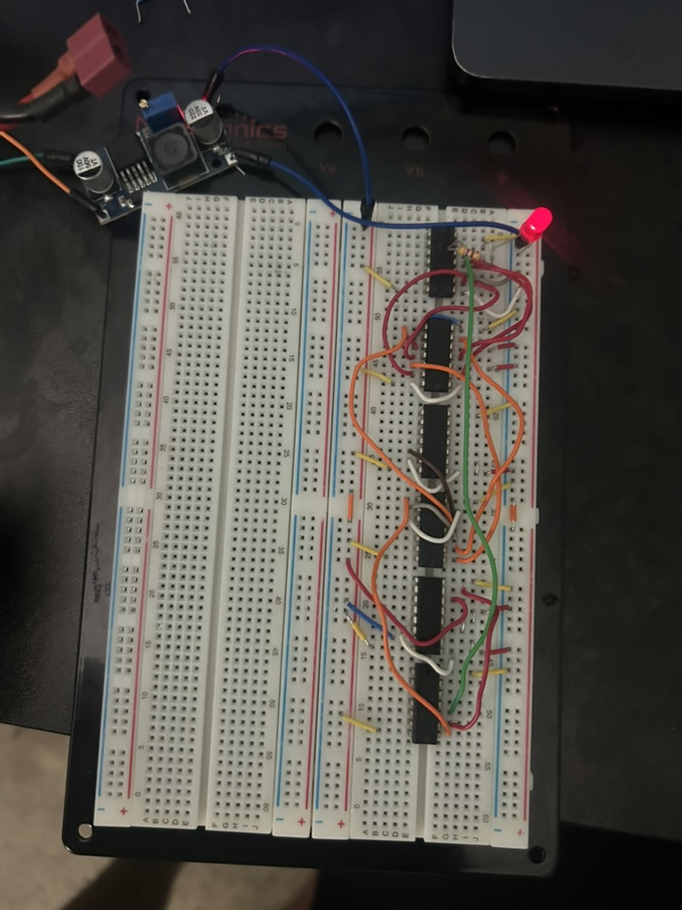
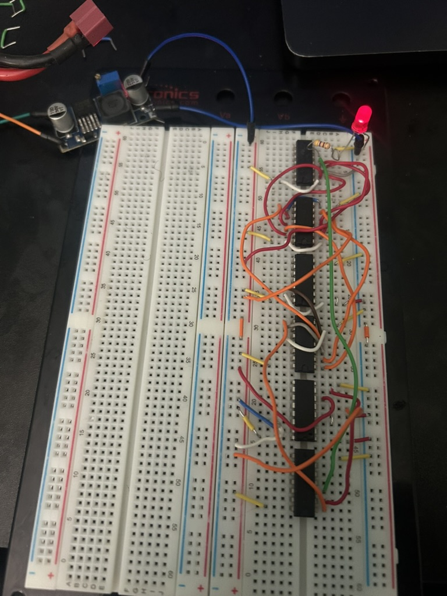
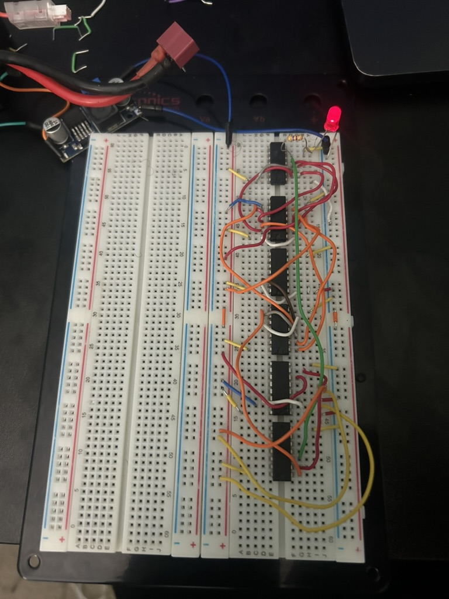
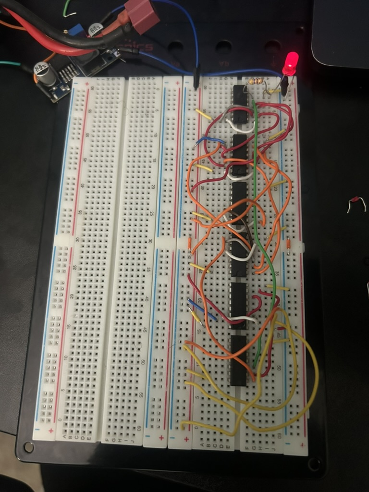
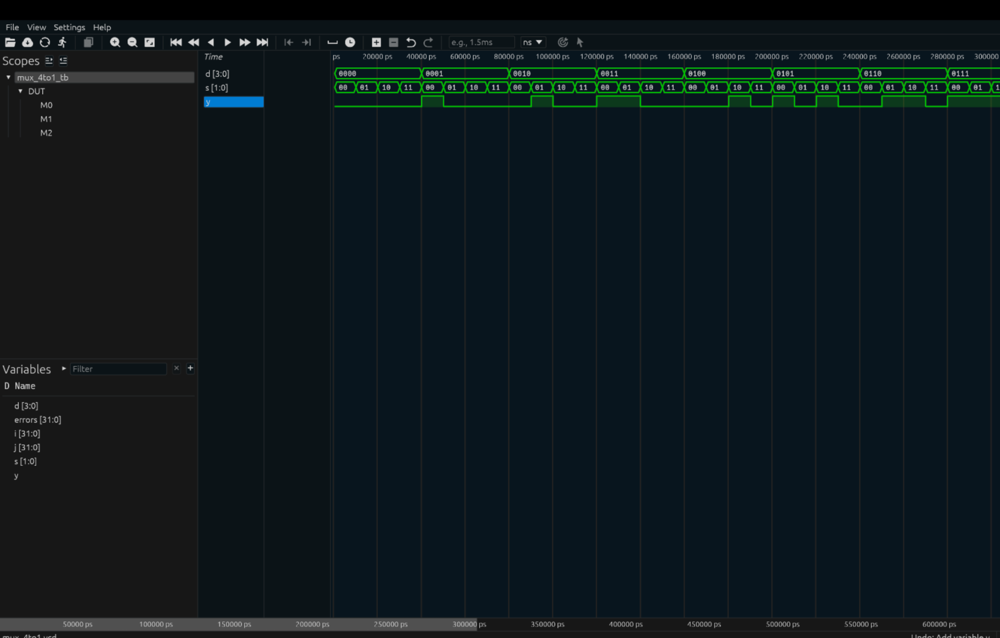

# Lab 5 - 4-to-1 Multiplexer and Hierarchical Verilog

## Overview

This lab focused on designing, constructing, and verifying a 4-to-1 multiplexer using both physical digital logic hardware and Verilog HDL.

A gate-level 4-to-1 multiplexer was constructed using 74LS-series integrated circuits and compared against a 74LS153N multiplexer. A comparator circuit was used to verify that both implementations produced the same output.

The multiplexer was also implemented in Verilog using hierarchical design by combining multiple 2-to-1 mux modules.

## Hardware Used

- 74LS04 Hex Inverter
- 2 × SN74LS11 Triple 3-Input AND Gate ICs
- 74LS32 OR Gate IC
- 74LS153N 4-to-1 Multiplexer
- 74LS86 XOR Gate IC
- Breadboard
- LED
- Current-limiting resistor
- 5 V power supply
- Jumper wires

## 4-to-1 Multiplexer Logic

The multiplexer uses two select inputs, `S1` and `S0`, to choose one of four data inputs.

| S1 | S0 | Selected Input |
|----|----|----------------|
| 0 | 0 | D0 |
| 0 | 1 | D1 |
| 1 | 0 | D2 |
| 1 | 1 | D3 |

The Boolean expression is:

Y = D0S1'S0' + D1S1'S0 + D2S1S0' + D3S1S0

## Physical Implementation

The manually constructed mux used:

- 2 inverter gates to generate `S0'` and `S1'`
- 4 three-input AND gates
- 3 OR gates

The output of the manually constructed mux was compared with the output of the 74LS153N.

A 74LS86 XOR gate and an unused inverter from the 74LS04 were used to create a comparator. The LED turned on when both mux outputs matched.

## Physical Testing

All four select combinations were tested.

### D0 Selected - S1S0 = 00

### D1 Selected - S1S0 = 01

### D2 Selected - S1S0 = 10

### D3 Selected - S1S0 = 11

The comparator LED remained on during all four tests, confirming that the manually constructed mux and the 74LS153N produced matching outputs.

## Verilog Implementation

The Verilog design used hierarchical construction.

A 2-to-1 mux was first implemented as its own module. Three 2-to-1 mux modules were then combined to create the 4-to-1 mux.

- `M0` selects between `D0` and `D1`
- `M1` selects between `D2` and `D3`
- `M2` selects between the outputs of `M0` and `M1`

### Files

- `mux_2to1.v` - 2-to-1 mux module
- `mux_4to1.v` - hierarchical 4-to-1 mux module
- `mux_4to1_tb.v` - testbench
- `mux_4to1.vcd` - simulation waveform data

## Simulation

The testbench checked:

- 16 possible data input combinations
- 4 possible select combinations
- 64 total test cases

Simulation result:

PASS: All 64 combinations passed.

## Simulation Waveform

## Tools Used

- Verilog HDL
- Icarus Verilog
- Surfer
- VS Code
- Breadboard hardware
- 74LS-series logic ICs

## What I Learned

This lab demonstrated how larger digital circuits can be built from smaller reusable modules. It also showed how hierarchical design can be applied in both physical hardware and Verilog HDL.

The project reinforced the relationship between Boolean logic, gate-level hardware, modular HDL design, simulation, and physical testing.
